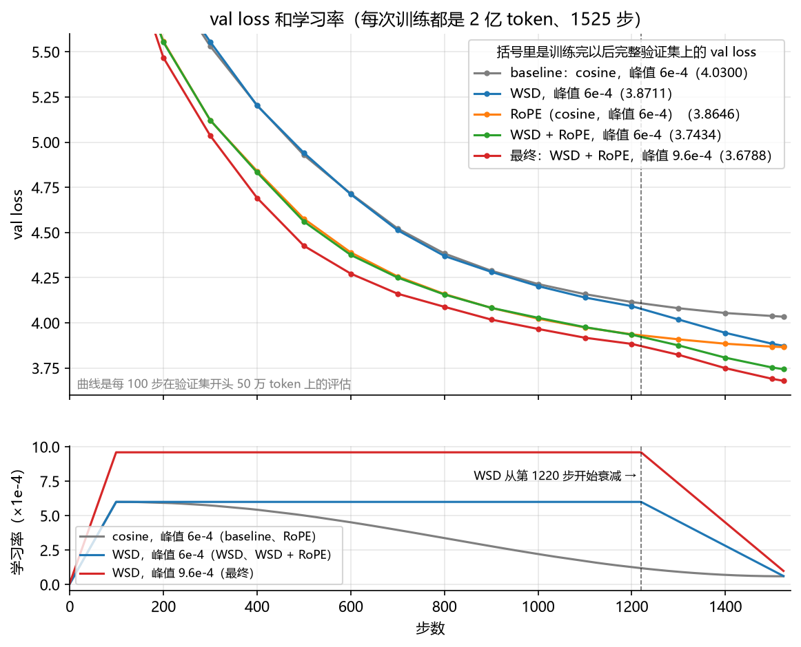
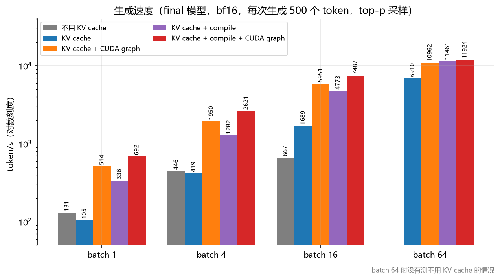
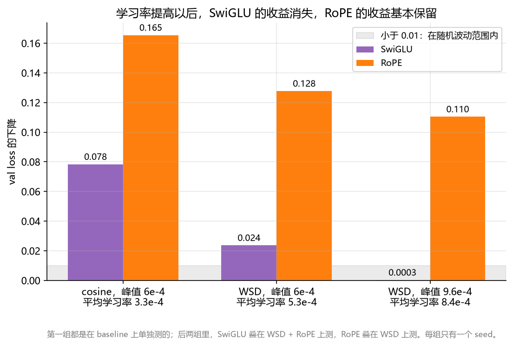

# nanoGPT：在一张笔记本 GPU 上从零训练 GPT-2（124M）

在一张笔记本 RTX 5070 Ti（12 GB）上从零训练 GPT-2 small（124M），训练量固定为 2 亿 token，每次只改一处，逐项对比训练和推理的优化。

- **训练效果：** val loss 从 baseline 的 4.0300 降到 3.6788。
- **训练速度：** 整次训练从 84.8 分钟降到 75.9 分钟。
- **生成速度：** batch 1 时从 131 token/s 提高到 692 token/s。

每个实验的设置、对照、随机波动和分析都在 [EXPERIMENTS.md](EXPERIMENTS.md)，原始数据在 [results/](results/)。

## 结果

| | baseline | 最终配置 |
|---|---|---|
| val loss（FineWeb-Edu） | 4.0300 | **3.6788** |
| Shakespeare loss | 4.5427 | **4.3386** |
| 整次训练耗时 | 84.8 min | **75.9 min** |
| 训练吞吐量 | 40.8k token/s | **46.3k token/s** |
| MFU | 59.2% | **67.1%** |

- **最终配置：** WSD 学习率调度（峰值 9.6e-4）+ RoPE + GELU，开 `torch.compile` 和 cuDNN 注意力。
- **参考：** OpenAI 的 GPT-2 124M 用同样的方法评估是 3.2764 和 4.0005。它的训练量大得多，这里只训练了 2 亿 token，相当于每个参数 1.6 个 token。
- **MFU：** 按这张卡实测的 bf16 矩阵乘法峰值（59 TFLOPS）计算，不能和按标称峰值算的 MFU 直接比较。



WSD 在学习率保持不变的阶段和 cosine 差不多，到最后 20% 学习率线性降下来时才拉开差距；RoPE 从一开始就领先。

## 做了哪些改动

**训练效果**（同样 2 亿 token 下 val loss 的变化，对照和细节见 EXPERIMENTS.md）：

| 改动 | 结果 | 采用 |
|---|---|---|
| 学习率调度从 cosine 换成 WSD | 比 baseline 低 0.159。其中约 0.12 来自更高的平均学习率，WSD 形状本身的作用是 0.039（用平均学习率相同的 cosine 做对照） | 是 |
| 位置编码换成 RoPE | 比 baseline 低 0.165；在最终配置上去掉它，升高 0.110 | 是 |
| 峰值学习率从 6e-4 提高到 9.6e-4 | 在 WSD + RoPE 上低 0.063 | 是 |
| MLP 换成 SwiGLU | 比 baseline 低 0.078；但在最终学习率下只低 0.0003 | 否 |
| MLP 换成 4 个专家的 MoE（每个 token 的计算量不变） | 比最终配置低 0.0105，刚过门槛，但每步慢 22% | 否 |

**训练速度：**

| 改动 | 结果 | 采用 |
|---|---|---|
| `torch.compile` | 吞吐量提高 9–10%（用 RoPE 时约 16%），显存少约 20% | 是 |
| cuDNN 注意力 | PyTorch 默认不会选它，手动指定后每步快 6% | 是 |
| RMSNorm | 测不出加速 | 否 |

**生成**（[transformer/sample.py](transformer/sample.py)）：top-p 采样、KV cache、CUDA graph 和 `torch.compile`。batch 1 时从 131 提高到 692 token/s，batch 16 时从 667 提高到 7487 token/s。



## 几个发现

1. **学习率比结构改动更关键。** baseline 的峰值学习率 6e-4 对这个训练量偏低，WSD 的收益大部分来自它的平均学习率更高。
2. **学习率偏低时测出的结构收益，到最终学习率下可能消失。** SwiGLU 的收益从 0.078 降到 0.024，再到测不出（0.0003）；RoPE 仍保留了 0.110。所以结构改动要在接近最终使用的学习率下再验证一次。

   

3. **MoE 的计算量和 dense 一样，却慢了 22%。** 用 profiler 和一个不同步的对照版本拆开看，约 58% 来自 `torch._grouped_mm`：它在这张卡（计算能力 12.0）上走的是退回实现，每次调用都要同步一次 CPU 和 GPU，每个 micro-batch 同步 72 次。
4. **batch 1 生成时，KV cache 本身没有加速。** 这时 GPU 只有约 10% 的时间在算，其余时间都在等 CPU 逐个提交 kernel。CUDA graph 解决的就是这部分开销。再加 `torch.compile` 时要打开 Inductor 的 freezing，否则编译后的代码每步都把权重重新转成 bf16，反而比只用 CUDA graph 更慢。
5. **随机波动不能忽略。** 只换 seed 的两次 baseline，val loss 差 0.0084，所以下降小于 0.01 的改动不算有效。只改计算方式的两次训练，Shakespeare loss 也差了 0.021。

## 实验方法

- **训练量：** 每次训练都是 199,884,800 token（1525 步 × 每步 131,072 token），micro-batch 4 × 1024，梯度累积 32 次，bf16。
- **控制变量：** 每次只改一处。seed 相同时，取 batch 的顺序也完全相同。
- **判断标准：** val loss 下降小于 0.01 不算有效；0.01–0.02 之间要换一个 seed 再跑一次；超过 0.02 算有效。
- **速度测试：** 不做改动的对照组在改动前后各跑一次，比较稳定阶段每步耗时的中位数。
- **记录方式：** 没有提升的实验也照样记录，见 EXPERIMENTS.md。

## 运行

环境：Windows 11，Python 3.11，PyTorch 2.11（CUDA 12.8）。在 Windows 上用 `--compile` 需要另装 triton-windows 3.6（这里用的是 3.6.0.post26）。

```bash
pip install torch --index-url https://download.pytorch.org/whl/cu128
pip install -r requirements.txt
pip install -U "triton-windows<3.7"   # 只有 Windows 上用 --compile 时需要

# 数据：FineWeb-Edu（训练和验证），tiny shakespeare（只用来评估）
python -m prepare.fineweb_edu
python -m prepare.shakespeare_char
python -m prepare.shakespeare

# 训练最终配置（这台机器上约 76 分钟）；不加参数就是 baseline
python transformer/train.py --run_name final --schedule wsd --pos_emb rope --learning_rate 9.6e-4 --min_lr 9.6e-5 --compile --sdpa_backend cudnn

# 生成；生成的 token 多时可以加 --compile（第一次要编译 7–11 秒）
python transformer/sample.py --prompt "The history of the Roman Empire"

# OpenAI GPT-2 的参考值
python transformer/eval_gpt2.py --dataset fineweb_edu
```

## 目录

| 路径 | 内容 |
|---|---|
| [tokenizer/](tokenizer/) | 自己实现的字符级和 BPE tokenizer（BPE 可以从文本训练，用 GPT-2 的切分规则） |
| [prepare/](prepare/) | 数据准备 |
| [transformer/model.py](transformer/model.py) | GPT 模型，可选 RoPE、SwiGLU、RMSNorm、cuDNN 注意力、MoE，以及生成用的 KV cache、CUDA graph |
| [transformer/train.py](transformer/train.py) | 训练：cosine / WSD 学习率调度、梯度累积、bf16、`torch.compile` |
| [transformer/sample.py](transformer/sample.py) | 生成 |
| [transformer/eval_gpt2.py](transformer/eval_gpt2.py) | 评估，也用来算 OpenAI GPT-2 的参考值 |
| [results/](results/) | 每次实验的 `config.json`、`log.csv` 和 `summary.json`；`benchmarks/` 里是生成速度和 MoE 耗时拆分的测试结果 |
| [figures/](figures/) | 画图脚本 `plot.py` 和生成的图 |
| [EXPERIMENTS.md](EXPERIMENTS.md) | 完整的实验记录 |

代码结构参考了 Andrej Karpathy 的 [nanoGPT](https://github.com/karpathy/nanoGPT)。
